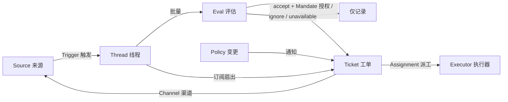

# 02 领域模型

> 来源：官方 `docs/001-domain.md`，辅以 `src/core/model.ts`、`src/core/engine.ts`、`src/core/stage.ts` 的实现核对。
> 领域模型刻意保持**概念最少**——一个新业务需求要么成为现有概念的属性，要么成为提示词，绝不新增概念；被拒绝的候选概念有一张正式的"拒绝表"。

## 1. 工作流总图

工作从 Trigger 流向 Eval 再流向执行。Source 产生 Trigger；Trigger **扇出**为上下文投递给订阅其 Thread 的所有 Ticket；除此之外每个 Trigger 进入 **Eval**，由 Eval 判断它是否要求新工作。Eval 接受 ⇒ 以 Mandate 创建 Ticket；**Assignment** 把 Ticket 交给 Executor；结果经 **Channel** 回到 Source。

**两条路径**（贯穿全部设计的关键区分）：

- **Eval 路径**："是否开始/继续/停止新工作"——要过门控与研判，产生 Decision；
- **订阅扇出路径**："已有工作的上下文延续"——绕过门控、不产生 Decision、**不授予任何新权限**，票的边界始终由它的 Mandate 决定。

## 2. 核心概念表

| 概念 | 定义 | 保有规则 | 存在理由 |
| --- | --- | --- | --- |
| **Source 来源** | 事件流。kind（可复用实现）+ instance（一份配置：是否运行、监听什么） | 保存读位置与自己的 bot 身份；定义何为事件（含跨时间成立的条件）；在进入领域**之前**丢弃 bot 自身消息与范围外 Trigger；把 Trigger 翻译为所属 Thread 与可回复的 Channel 地址 | 重启不得重放事件 |
| **Trigger 触发** | 一条不可变事件，携带 Source 自己的元数据（如 actor） | 属于一到多个 Thread；同一 Trigger 被接受两次只产生一个 Ticket | 审计与幂等的单位 |
| **Thread 线程** | 时间序的 Trigger 序列；哪些 Trigger 构成一个 Thread 由 Source 定义 | 同时最多一个 Eval；可有多个 Ticket；持有订阅、运行中的 Eval、决定历史 | 给 Eval 一致的视图与上下文 |
| **Correlation 关联** | 同一 Trigger 所属的 Thread 间的关系 | 只加上下文；**绝不路由** | 让 Eval 追踪相关证据 |
| **Channel 渠道** | Thread 的写侧；地址由 Source 定义 | 一个 Thread 可有多个 Channel；Ticket 持有它们的集合 | 确认、回复、PR、已解决评论都是写 |
| **Policy 策略** | 版本化的研判规则 + 每个 Source 的部分：谁可通过它发起工作（该 Source 自身身份体系内的名单）、名单如何同步、哪些 bot 可产生候选 | 策略版本覆盖规则 + accept 模式 + Source 部分；对在票的生效变更（如其所依赖的规则变了）作为通知**送达 Assignment**，**不撤销 Mandate**；不同 Source 的身份永不互相映射 | 规则变更时运行中的 Eval 必须作废 |
| **Eval 评估** | 对一批 Trigger 的判断，两层：gate（确定性准入）+ assessment（模型研判） | 输入：批、Thread 快照、Thread 上全部票（含已结束）、当前 Policy；输出：一个 Decision；自身无状态 | 决定新工作是否开始、继续或停止 |
| **Mandate 授权** | 一次 accept 所授予的东西：Policy 版本、scope、强度、匹配规则、发送者在该 Source 上的身份、Source 收到此 Trigger 的方式 | **不可变**；更大 scope ⇒ 新票。票的结束不结束它：只有人的 stop 撤销它、失效的 Policy（revalidation 不过）撤销它；票恢复前须按当前 Policy 重验 | 声明为什么可以干、能干到哪 |
| **Ticket 工单** | 一单位已授权的工作 | 只有 Eval 能创建；引用 Mandate；持有 Channels 与 Inputs。open → ended，且其自有 Thread 上的人的消息可**恢复**（除非被 stop）。**自己定义状态**，不跟随 Executor | 拥有执行与其报告 |
| **Assignment 派工** | Ticket 与一个 Executor 实例的绑定 | 一票可有多次（随时间）；pending → running → ended 独立于票；只有其最终报告可在 Executor 侧终结票 | Executor 在领域之外，但"谁在执行"必须在领域之内 |
| **Subscription 订阅** | Ticket↔Thread 的多对多关系，由 Thread 持有 | 匹配 Trigger **不检查发送者**地扇出给每个在票订阅者；人消息由此到达票即归该票（不走 Eval）。Executor 为上下文跟随的 Thread 同样送达但**不借出授权、不恢复票**。已结束票保留订阅：人消息以原 Mandate 恢复（无 Eval/Decision）；bot/CI 消息不达（执行器恢复时自会重读 Thread）。被 stop 的票什么都收不到。主会话**只在消息显式指向**某票时 attach；人可解除 Thread 全部订阅；Executor 只能解除自己票对"判定无关 Thread"的订阅（起点 Thread 与 Source 要求跟随的 Thread 除外） | 后续讨论**无需再 @ agent** 即到达执行器 |

**刻意不设的概念**："人（person）"不是领域概念——Trigger 携带 Source 原生的 actor 标识；允许名单是 Policy 的 Source 部分；"同一个人在多个平台有多个账号"只是提示词文本。Executor 及其 Session、目录在领域之外，仅通过 Assignment 连接。

## 3. 实现层的关键类型（`src/core/model.ts`）

| 类型 | 字段要点 |
| --- | --- |
| `Trigger` | `{ id, source, threads[]（threads[0] 为主）, actor, human, addressed?: 'mention'\|'direct', at, text, channel?, url?, meta }`；不可变；`text`/`meta` **视为不可信数据** |
| `TriggerDisposition`（去向） | `{ filtered?, evalId?, decisionId?, fanout: ticketId[], context?, requeued?, handbacks[], acked[], at }`——每条消息完整旅程的可审计记录 |
| `Thread` | `{ key, ref, createdAt, lastAt?, subscriptions[], context[]（仅上下文跟随者）, correlated[], pending[]（Eval 去抖缓冲）, evaluating?, expired?, meta }` |
| `Evaluation` | `{ id, threadKey, triggerIds, primary?, strength, actor, basis, policyVersion, startedAt, delivered?, deadline, pausedAt? }`——每 Thread 最多一个；deadline 从**候选送达主会话**起算 |
| `Decision` | `{ id, evalId, kind: 'ignore'\|'accept'\|'reopen'\|'stop'\|'unavailable', reason: Reason[], strength, ticketId?, mandate?, audit?, dismissed? }` |
| `Mandate` / `MandateBasis` | `{ strength: 'explicit'\|'inferred', policyVersion, basis, actor, scope }`；`basis.via ∈ addressed\|followup\|admission\|listed\|bot`（admission 还带命中的准入表 cell 与 rules）——**不可变授权凭据** |
| `Ticket` | `{ id, title, decisionId, mandate, channels[], ended?, attention?, assignments[], inputs[], undelivered, follows?, answers?, origin, execution?, delivery? }`；状态为**派生值**（`stage.ts`） |
| `Assignment` | `{ id, state: 'pending'\|'running'\|'ended', report?: { state: ReportState, summary, question? }, deliveredAt, idleAt }`；`ReportState ∈ progress\|waiting\|ready\|blocked\|failed\|dropped` |
| `TicketInput` | 判别联合：`trigger`（含 `human?`、`readAt`）、`policy-changed`、`resumed`、`text`、`note` |

共享谓词（保证规则一致实现）：`waitsForPerson`（最新报告为 blocked/failed 且之后无人消息）、`followupOwners`（仍对某人类 follow-up 负责、未上报未接手的票）、`settled`（决定是否真正了结请求）、`ticketStage`（派生阶段表）。

**id 全部内容寻址**：`src/core/ids.ts` 的 `key(...)` 对参数 JSON 取 sha256 截 32 hex——相同输入必得相同 id，这是全系统幂等性的基石（见 [06](06-可靠性与数据完整性.md)）。

## 4. Ticket 状态（派生 stage 表，`src/core/stage.ts`）

从上往下第一个匹配生效。`person/*` 阶段=无人的输入无法继续：

| 阶段 | 条件 | 面板标签 |
| --- | --- | --- |
| person / delivery | 投递 Input 失败（2s 起指数重试） | Input undelivered |
| person / answer | 有 Attention（待人回答的问题） | Awaiting answer |
| person / review | 最新报告 `ready` | Awaiting review |
| person / blocked, failed | 最新报告 blocked/failed 且之后无人的消息 | Blocked · Failed |
| working / queued | 无 Assignment 或 pending | Queued |
| idle | 最新报告 `waiting` 或 Assignment 已结束 | Waiting for a Trigger |
| working | 其余 | Working |

终结结果 `TicketOutcome`：`completed | merged | closed | dropped | stopped`。

## 5. 聚合与不变式

- **Source** 聚合持有自己的读位置；
- **Thread** 聚合持有订阅、运行中的 Eval（串行；期间到达的 Trigger 并入下一批）、决定历史；
- **Ticket** 聚合持有 Assignments、Channels、Inputs，按 id 引用 Decision。
- 每类状态**只有一个写入者**（Engine 写 Trigger/Thread/Decision/Ticket/Assignment；Source 只写自己的游标与 Thread meta；Settings/Prompts/Effects/Outbox 各自唯一写入）——这是并发正确性的结构性保证。

## 6. 被拒绝的概念（官方"拒绝表"，架构品味所在）

| 被拒绝 | 理由 |
| --- | --- |
| 把 Principal/Membership 设为实体、跨 Source 映射身份 | 人只是 Trigger 元数据；允许名单是 Policy 的 Source 部分；跨平台映射是提示词 |
| Eval 调度自己的延迟 Trigger | "需要等待的条件"就是普通 Source ⇒ Eval 永不反向依赖 Source |
| "等待中/已撤销"的 Eval 状态 | 等待属于 Source；超时的 Eval 重新排队 Trigger 或终结为 `unavailable` |
| 每 Thread 最多一张在票 | 一个 Thread 可以承载多件独立工作；由研判对照票列表去重 |
| "追加到票"的 Decision | 追加 = 订阅扇出，无需 Eval |
| 对订阅做准入检查 | 订阅覆盖整条 Thread；Mandate 已把授权与上下文分开 |
| Correlation 参与路由 | 订阅负责路由；Correlation 只加上下文 |
| 票状态跟随 DSH Session | 票可被交接、恢复、多次派工 ⇒ 必须自定义状态 |
| Executor 宣称"有人让我停" | 只有 Eval 能决定停止的强度（面板 stop 是直接命令，记录为人工停止） |
| Policy 变更取消运行中的票 | 会留下半成品；变更被记录并作为通知送达 |
| 失败/阻塞时锁死 Executor 会话全部工具 | 会拒绝人直接进会话干活；暂停自动输入就够了 |
| 从报告自由文本推断"在等人" | 分类需要结构化事实 ⇒ 走结构化 attention 字段 |

## 7. 术语表（中英对照）

源自官方 glossary，另补充实现术语：

| 术语 | 中文 | 含义 |
| --- | --- | --- |
| Agent | 智能体 | dsh-superagent 运行的自动化团队成员 |
| Main Session | 主 Session | 评估 Trigger、接单派票、回复；代码与提示词中称 `orchestrator` |
| Executor Session | 执行器 Session | 一个 Ticket 一个；代码中称 `worker` |
| Source / Trigger / Thread / Correlation / Channel | 来源 / 触发 / 线程 / 关联 / 渠道 | 见上文概念表 |
| Policy / Policy version | 策略 / 策略版本 | 版本化规则与各 Source 部分；每个 Mandate 记录其版本 |
| Eval / Gate / Assessment / Decision | 评估 / 准入 / 研判 / 决定 | 两层评估与其结果 |
| Mandate | 授权 | 一次 accept 授予的强度、scope、策略版本 |
| Ticket / Assignment / Subscription / Fan-out | 工单 / 派工 / 订阅 / 扇出 | 工作单元及其流转 |
| Executor / Execution environment | 执行器 / 执行环境 | 执行派工的端口；变量注册表 |
| Report / Attention / Disposition / Input / Scope / Strength | 报告 / 待人工决定 / 去向 / 输入 / 范围 / 强度 | 执行报告、结构化提问、旅程记录、上下文投递、授权边界、授权强度 |
| Admission table | 准入表 | 每个 Source 的 3 格接收矩阵（见 [04](04-事件驱动与授权.md)） |
| Effects | 效果队列 | 持久化副作用队列（launch/delivery/relay/notice/reply/assessment） |
| Outbox | 发件箱 | 渠道出站消息与回执的唯一写入者 |

决策值域：`accept 接单 · stop 停止 · ignore 忽略 · unavailable 未完成`；强度：`explicit 明确 · inferred 推断`；派工：`pending 待启动 · running 执行中 · ended 已结束`；报告：`progress 进展 · waiting 等待 · ready 就绪 · blocked 受阻 · failed 失败 · dropped 无需处理`。
