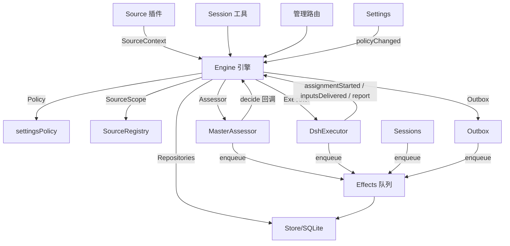

# 03 总体架构

> 来源：官方 `docs/007-architecture.md`（开发指南），对照 `src/` 实现核对。
> 一句话概括分层：**core 是零 I/O 的事务化领域核心；app 是编排与持久化；sources/executor 是外部边界的适配器；client 是面板。**

## 1. 技术栈与打包形态

- TypeScript（Node 22.19+/24），pnpm + tsdown + vitest + zod（配置校验）；
- 宿主为 DeepSeek Harness（`dsh`），本体是一个 **bundle**：`package.json` 的 `dsh.bundle.patch` 指向 `cordis.patch.yml`，插入三个插件——`dsh-superagent`（主）、`dsh-superagent-github`（github-watch）、`dsh-superagent-feishu`（feishu-watch，**默认停用**），并定义两个 agent 预设（router/worker）；
- 无独立 CLI 入口：一切运行在 DSH 进程内；`scripts/dsh-superagent` 是 tmux + 健康检查的**服务管理脚本**（Python）。

## 2. 目录分层

| 目录 | 职责 | 关键约束 |
| --- | --- | --- |
| `src/core/` | 领域核心：Engine、五个 EnginePart、领域类型、端口 | **零 I/O**，除 Node 的 sha256 外不 import 外部；一切方法同步、命令体包在 `repo.atomic(...)` 事务里 |
| `src/app/` | 应用编排：Runtime（组合根）、Store（SQLite）、Effects（副作用队列）、Passes（心跳）、Outbox、Sessions、Assessment、Settings、Prompts、HTTP API、views、cards/resources | 唯一持有外部世界副作用的地方 |
| `src/sources/` | Source 插件适配器：GitHub、飞书 + registry/poll/admission-context | **不 import `src/app`** |
| `src/executor/` | DshExecutor（worker 会话/目录/槽位）与 worker 后台作业管理 | 通过 Effects 队列干活 |
| `src/infra/` | CLI 传输（gh/lark/git）、进程环境、路径、健康板、文本工具 | — |
| `src/client/` | Web 面板（React）：overview/source/trigger/eval/execution/settings 页 | 只 import 宿主侧的**类型**与少量纯值模块，无循环 |
| `prompts/` `skills/` | 内置提示词（一句一行，`promptFile` 拼接）与 Source 技能 | 团队可覆盖（见 [07](07-提示词体系.md)） |

## 3. 组件图（核心类与端口）

**Engine（`src/core/engine.ts`）**：领域状态（Trigger/Thread/Decision/Ticket/Assignment）的**唯一写入者**。它有一个对外入口与五个内部部件，部件间依赖单向：

| 部件 | 职责 | 依赖 |
| --- | --- | --- |
| `Intake`（intake.ts） | Source 来的 Trigger：一次性存储 + 去向记录 → 挂 Thread 与关联 → 扇出到订阅票 →（除非人消息已归某票）排队进 Eval | Tickets |
| `Evals`（evals.ts） | 各 Thread 的评估：批量、门控强度与依据、deadline 与暂停偏移、超时重排、候选、回放、收回，及各 Decision（accept/stop/ignore/unavailable） | Tickets |
| `Tickets`（tickets.ts） | 票生命周期：accept 创建、订阅、follows 与关闭、输入、恢复与拒绝恢复、重试、重启、停止与终结、解除订阅、Policy 变更通知 | Replies |
| `Assignments`（assignments.ts） | Executor 报告的事实：started、输入送达/失败、重启中断、worker Report 与提问 | Tickets, Replies |
| `Replies`（replies.ts） | 经 Outbox 的渠道写：acknowledgement / answer / result / attention，各有一一对应的授权规则 | 无 |

命名约定承载语义：**祈使句 = 请求**（可被拒绝，如 `stopTicket`）；**过去式 = 记录适配器已发生的事实**（如 `assignmentStarted`）；查询用名词（`candidate`）。

**角色切片**：调用方只拿到自己角色的 `Pick`：`EngineForSources / EngineForMainSession / EngineForPeople / EngineForSettings / EngineForExecutor`——一个插件拿不到它不该调的命令。

## 4. Runtime（组合根）与启动/停机

`src/app/runtime.ts` 无领域规则：锁 stateDir（proper-lockfile）→ 打开 Store → 逐个构建组件（失败则关闭并释放锁）。

**启动序列**：注册管理路由 → 跑 Setup（探测 gh/lark-cli 身份）→ 安装 Session/Executor 钩子 → 确保主会话存在（`orchestrator-<hash>`）→ 启动 Policy 同步 → `executor.resume()`（恢复被中断的 Assignment，最老的票优先）→ `passes.start()` → `effects.start()` → `ready`。

**停机序列**：取消进行中的 turn → 等待 passes/effects/agent → 恢复进程环境 → 关 Store → 释放锁。给每个 worker 的后台作业最多等 10 秒。

**Passes（passes.ts）**：编排心跳——每 2 秒一个 pass（单飞 pump，期间被请求的 pass 合并为一个尾随 pass）；一个 pass = `effects.kick()` + `engine.evaluateDue()`。所有触发源（Source receive、工具调用、HTTP）最终都汇入这条心跳。

## 5. 依赖规则（架构的"法律条文"）

1. **显式窄依赖**：每个类只拿到接口（多为其他类的 `Pick`）：核心类用 `ExecutorHost/AssessorHost/SessionsHost/SettingsHost/SetupHost/PassesHost/OutboxHost`；胶水用 `HttpHost/MainToolsHost/…`；Source 插件只见 `SourceHost`（registry + `context(kind)`）→ 其 kind 只见 `SourceContext`。
2. **import 方向**：core 不依赖 core 外任何东西（无 I/O）；sources 不依赖 app；面板只 import 类型与纯值模块。
3. **单一写入者**（每类状态一个写入者，其余只读或委托）：

| 状态 | 写入者 |
| --- | --- |
| Trigger/Thread/Decision/Ticket/Assignment | Engine |
| Source 读位置与 Thread `meta`（label/url/facts） | 该 Source（经 `SourceContext`） |
| Settings 及历史 | Settings |
| 提示词版本 | Prompts |
| Effect 行 | Effects |
| Outbox 回执 | Outbox（Engine 的消息与 Source 的 notify 都经其 `send`） |
| 健康条目 | 在 HealthBoard 上声明/认领它的那个部件（重复认领被拒） |

4. **类型化字段与 Source 数据隔离**：代码只读 Ticket/Mandate 的类型化字段；Source 不在 Ticket 上放东西——票跟随哪些 Thread 是票的 `follows` 字段，Source 私有信息放 `meta`。
5. **固定拒绝**：人/agent 可引发的拒绝 = `UserError(code)`（`src/core/errors.ts`，48 个编码消息）；管理 API 对 `missing` 回 404、其余回 400；面板按码本地化。

## 6. 模块地图（浓缩索引）

完整逐文件表见官方 `docs/007-architecture.md` §Modules；此处按子目录给导航：

- **core**：`engine.ts`（入口+角色接口）/ `model.ts`（类型+谓词）/ `ports.ts`（Repositories、Policy、SourceScope、Assessor、Executor、Outbox、12 种 DomainEvents）/ `intake|evals|tickets|assignments|replies.ts` / `stage.ts` / `errors.ts`（UserError）/ `reasons.ts`（18 个结构化原因码）/ `ids.ts`（key=sha256）/ `memory.ts`（**注意：名字叫 memory 却不是 agent 记忆**——是测试用的内存版 Repositories，带快照回滚）
- **app**：`runtime.ts` / `passes.ts` / `effects.ts` / `store.ts`（表+generated columns）/ `store-read.ts` / `migration.ts`（schema 10→11）/ `outbox.ts` / `notices.ts` / `delivery.ts`（AgentDelivery：按 requestId 至多一次送达） / `sessions.ts`（预设/工具限制/noWait 守卫） / `assessment.ts`（MasterAssessor） / `settings.ts` / `settings-history.ts` / `prompts.ts` / `context.ts` / `skill-files.ts` / `cards.ts`（票卡闭集状态）/ `resources.ts`（orchestrator_read 语法）/ `cache.ts`（LRU TextCache）/ `links.ts` / `retry-health.ts` / `role-models.ts` / `execution-environment.ts` / `source-context.ts` / `http.ts` / `api.ts` / `tools/main.ts`+`tools/executor.ts` / `views/*`
- **sources**：`kind.ts`（SourceKind 协议）/ `registry.ts` / `host.ts`（SourceHost/SourceContext/Health）/ `poll.ts`（游标/去抖/14 天窗口）/ `admission-context.ts`（研判窗口）/ `github*.ts`（轮询轮次→翻译→PR 绑定→渠道→读）/ `feishu*.ts`（事件消费→翻译→循环→渠道→读→图片）
- **executor**：`dsh.ts`（DshExecutor + WorkerSlots + inputMessage[1500/600 字符截断]）/ `background.ts`（untilQuiet/killJobs/stopSubagents）
- **根文件**：`index.ts`（插件入口）/ `deployment.ts`（Config：stateDir 必填 + 违键拒绝）/ `setup.ts`（SetupError 目录）/ `policy.ts`（settings schema + gate/revalidate/assessmentOutcome/policyVersion）/ `admission.ts`（3 格准入表）/ `limits.ts` / `kv.ts`（全部 KV 键的注册表）/ `navigation.ts`

## 7. 持久化

**一个 SQLite 文件** `<stateDir>/orchestrator.sqlite`（WAL、`synchronous=FULL`），只有 Store 打开它；Runtime 先拿目录锁再开库（防第二进程迁移/写入）。

| 表 | 内容 | 写入者 |
| --- | --- | --- |
| `trigger` | 每个 Trigger（`at` 统一 `toISOString`，文本可比较） | Engine |
| `disposition` | 每个 Trigger 的去向：filtered 原因码、Eval/Decision、扇出/attach 到的票、requeued、handback（含原因）、ack/answer | Engine |
| `trigger_thread` | Trigger↔Thread（含是否人写），支持 `<at>\|<id>` 游标翻页 | Store（随 Trigger 写入） |
| `thread` | 订阅、上下文跟随、待评估队列、运行中 Eval、过期计数、meta | Engine（Sources 写 meta） |
| `ticket` | Mandate、origin、execution、Assignments、Channels、Inputs、follows | Engine |
| `decision` | 各 Thread 的决定 | Engine |
| `effect` | 效果队列：per kind+key 一行、顺序、失败尝试与最后错误、到期时间 | Effects |
| `outbox` | 每条渠道消息的回执（pending/sent/dropped + 原因/时间） | Outbox |
| `kv` | 其余一切类型化记录（schema 版本、settings/prompt 版本、主会话 id、会话提示词履历、Source 游标/ETag/指纹、显示名） | 拥有该键的部件 |

**Generated columns 加速心跳**：`thread.active`（有排队 Trigger 或评估中）、`thread.subscribed`、`ticket.open`、`ticket.active`（有未送达输入或最新 Assignment 待启动/运行中）——每个 pass 只扫描活跃工作集。

**已知无界增长**（官方明示，尚未有清理机制）：trigger/disposition/decision 行、已结束票及其 Thread、outbox 回执、kv 中的 settings/prompt 历史版本与 Source 每 Thread 记录。schema 版本只增不减；新版迁移过的库拒绝被旧版打开（回滚必须用升级前备份）。

**读缓存**：有界 LRU `TextCache`（资源页 4MB、Source 链接 200KB），重启即失；会话翻页重启后必须从 offset 0 重读。

## 8. 配置热更新

除 `stateDir` 外的所有插件配置键都是**易失**的：DSH 配置表单改动写入 `cordis.patch.yml`，dsh-superagent 在使用点现读现生效，无需重启。但**会触发重启的例外**：改变 Setup 读取的 Source 字段（如账号 CLI），或 setup 未完成时的任何保存 ⇒ 自动重启进程（重启期间 API 短暂不可用，重启后自动恢复）。
