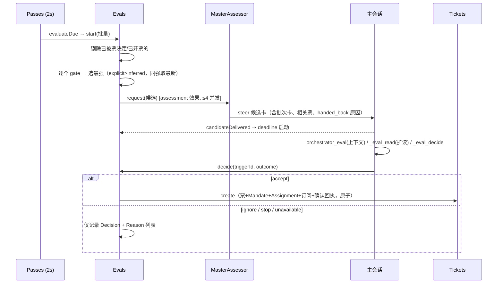

# 04 事件驱动与授权

> 来源：官方 `docs/002-authorization.md` 与源码 `src/sources/*`、`src/policy.ts`、`src/admission.ts`、`src/core/evals.ts`、`src/core/intake.ts`。
> 核心命题：**授权决定谁可以发起工作、工作可以包含什么；由宿主强制执行——消息、评论、被引用的文档都只是判定的输入，永远不能改写权限。**

## 1. Source 抽象与插件协议

```mermaid
flowchart LR
  subgraph SourceKind 插件契约
    SCHEMA[schema/fields 配置表单]
    SCOPE[scope 接收范围]
    CH[channel 渠道发送]
    TC[threadContext 会话读]
    POL[policy 允许名单+准入行]
    ENV[environment 执行变量]
  end
  REG[SourceRegistry] -->|SourceContext 窄接口| KIND[具体 kind: GitHub / 飞书 / 自定义]
  KIND -->|ctx.receive(trigger)| ENG[Engine.receive]
  REG -->|scope 判定| ENG
```

`SourceKind`（`src/sources/kind.ts`）声明：稳定 `kind` id、标题/描述（双语）、配置 `schema`（zod）与 `fields`（自动生成面板表单）、健康条目、可选的 `scope`/`channel`（allowed/send/link）/`threadContext`/`find`/`policy`/`environment`/`refreshLabels`。

插件拿到的 `SourceContext` 提供部署与 CLI 传输、setup 就绪状态、配置读取、`receive`、`atomic` 事务、类型化 KV state、Thread/Ticket 读与绑定、Outbox notify、健康上报。**插件只能写入自己认领的健康条目**；注销后继续上报是空操作。

内置两个 kind：

- **GitHub**：轮询轮次 = agent 账号通知 → 仓库级流（observe-all 开关下的新 Issue/PR/评论/默认分支 CI）→ 在票的 PR 与 CI → 订阅的 Thread；遵守 `X-Poll-Interval`、ETag/304、失败读保留在 Thread 上（404 也要重试——可能是失去私有仓库访问）；通知对象连续失败 24 小时后放弃该 Thread。
- **飞书**：`lark-cli event consume im.message.receive_v1` 常驻事件消费（失败 1s→60s 退避重启）+ 历史回填 + 订阅话题轮询（60s）+ 群名刷新（60s）+ 可从指定群同步允许名单。

**轮询共享件**（`src/sources/poll.ts`）：14 天 `POLL_HORIZON_MS`、`polled` 谓词（只轮询有在票或近活的 Thread）、时间游标 5 秒重叠回退、每 Thread 独立失败记录（`pollError`）。

## 2. Trigger 与 Intake

**Trigger 翻译规则**（决定整个系统的正确性）：

- **确定性 id**：`key('github', html_url, comment id, updated_at)` / `key('feishu', messageId)`——重放安全；编辑视作新事件须把版本编进 id（GitHub 用 `updated_at`）；
- **主 Thread** 是 `threads[0]`，拥有 Eval；其余 Thread 只加 Correlation 上下文；
- `actor` 用 Source 原生 id（允许名单里的就是它）；bot/CI 置 `human: false`；CI 无发送者 ⇒ 走准入表"未列出且未 @"格；
- `addressed: 'mention'|'direct'` 只在消息确实 @ 了 agent 时设置——这是 explicit 强度的来源；
- **绝不给 agent 自己的消息产生 Trigger**；
- 回复目的地放 `channel`（`channel.thread` 用于同票消息的有序投递）；Source 私有字段放 `meta`；`meta` 与 `text` 都**不可信**。

**Intake 流水线**（`src/core/intake.ts`，每步在 Engine 事务内）：

1. **去重**：id 已存在 ⇒ `duplicate`（同一 Trigger 被接受两次只产生一个票）；
2. **范围过滤**：经 `SourceRegistry.scope` 判定——kind 未装 ⇒ `source_not_installed`、实例停用 ⇒ `source_disabled`、否则 kind 的 `scope()` 返回 `{listened, observed, row?}`；范围外 ⇒ 存为 `filtered` + 原因码（面板可解释，绝不静默丢弃）；
3. **Thread 归属**与 Correlation 登记；
4. **扇出**：订阅该 Thread 的每个在票各得一个 `trigger` 输入（幂等；worker 正等人时，自动消息被扣住）；
5. **归属判定**：人的消息**经扇出到达某票** ⇒ 归该票的执行器决断（无 Eval）；**人的消息恢复了已结束票** ⇒ 立即恢复（除非处理暂停）；其余 ⇒ 进入其主 Thread 的 `pending` 批缓冲，等 Eval。

> 归属的关键谓词 `followupOwners`：票**自己的 Thread** 上的人类 follow-up 属于该票的 worker——主会话在此期间**只能 stop**（人要求时），accept/attach/ignore/requeue 一律拒绝。worker 可 `orchestrator_trigger_handback` 交还（每人一次、带原因、保留订阅）；全部归属者放手后才进入新一轮 Eval，候选卡携带各 worker 的交还原因。

## 3. 门控（Gate）与强度

`settingsPolicy(settings, scope)` 每次返回**无状态** Policy（`src/policy.ts`）：

| 强度 | 成立条件 |
| --- | --- |
| **explicit 明确** | 名单上的人 @ 了 agent；或在已有票的 Thread 上跟帖（follow-up）；或准入表某格设为 explicit |
| **inferred 推断** | 名单外的人在有票 Thread 上跟帖（除非该格显式设 explicit）；准入表某格设为 inferred；名单上的 bot 发出的候选（最多 inferred） |
| **不准入** | 其余一切 bot 消息；准入表 ignore 的一切；accept 模式为 `off` 时的一切 inferred |

**准入表**（每 Source 的 Policy 部分，3×3 格；`src/admission.ts`）：

| 格 | 选项 | 默认 |
| --- | --- | --- |
| 名单内、未 @ | inferred / ignore | **inferred** |
| 名单外、@ 了 | explicit / inferred / ignore | **ignore** |
| 名单外、未 @ | inferred / ignore | **ignore** |

行 = 接收范围（飞书：各配置群/其他群/私聊；GitHub：issues/pulls/comments/ci）。未 @ 的格只在"该范围接收全部消息"时可用（飞书群设"全部消息"、GitHub 开 observe-all）。CI 行只有最后一格。**把"名单外且 @"格设为 explicit** 即向该范围的所有人开放请求权（适合支持群）；inferred 候选仍受 accept 模式约束。

**bots 与自动化审查者**：GitHub App、`[bot]` 后缀、飞书 bot 是 bot；Source 可列出白名单 bot（如 `dependabot[bot]`）使其消息可成为 inferred 候选（必须 @ agent 或发在全收范围），bot 不能 explicit、不能 stop。**用普通账号跑的自动化审查者被视为人**——其评论照常扇出并产生 follow-up 通知，须在团队提示词里声明这类账号。

## 4. Eval：从批到决定

每 Thread 同时最多一个 Eval（`src/core/evals.ts`）：



要点：

- **超时**：`eval.timeoutSeconds`（默认 120，30–600），从**候选送达**起算——投递等待不计；未送达的候选永不过期；处理暂停使 deadline 平移而非过期。过期重排 Trigger，连续 2 次 `REQUEUES` 后第 3 次 ⇒ 记 `unavailable`；
- **研判产出校验** `assessmentOutcome`（`src/policy.ts`）：每条启用规则恰好判定一次、方向落定（`implementation_requested`、`target_basis` ≠ `undetermined`、无未决设计问题）、`intent_evidence` 引用证据、≥1 条启用规则命中；**observe 模式下正研判记为 ignore+"would accept"**，auto 模式才真正接单；
- **捷径**：候选卡明显不触任何启用规则（闲聊等）可直接从卡上 ignore，记录 `ignoredFromCard`；
- `evals` 健康条目报告最近一小时未 dismiss 的 unavailable；面板只在 24h 内、仍是最新判定、未被 dismiss、Thread 不在排队/评估中时才催人；
- Policy 版本变更 ⇒ 作废运行中的 Eval 并重排队 Trigger；对旧版本做的决定记 `unavailable` 并按新版本立即重评。

## 5. Mandate：不可变授权凭据

Accept 原子地铸出 `Mandate { strength, policyVersion, basis, actor, scope }`。`basis.via`：

| via | 准入依据 |
| --- | --- |
| `addressed` | 名单发送者 @ 了 agent |
| `followup` | 消息到达已有票的 Thread |
| `admission` | 准入表某格（`observation` 标记推断候选） |
| `bot` | 名单 bot 产生的推断候选 |

**只有三件事改变 Mandate**：accept 创建、人的 stop 撤销、revalidation 失败撤销。

**恢复前重验**（`Policy.revalidate`，按当前 Policy 检查 basis）：

- explicit follow-up 凭据直接通过；
- inferred 凭据要求仍处 `auto` 且匹配规则仍启用；
- 准入表凭据要求**今日表与名单下仍能取得不低于原有的强度**（把发送者移出名单可撤销其凭据）；
- bot 凭据要求 bot 仍在名单；
- 其余要求发送者仍在允许名单；
- 且 Source 仍在监听原 Thread（恢复要求 `listened`，不要求仍全收）。

重验失败 ⇒ 票保持 ended，其等待消息按"未到达任何票"处理（无其他归属则进 Eval），主会话不会被通知"曾到过 worker"；attach 被拒。

**Policy 版本 = hash(规则 + accept 模式 + 各 Source 的 Policy 部分[含 bot 名单])**（修订号 `mandate-v3`）。版本变更给**受影响的在票**发 `policy-changed` 输入（`policyEffects` 计算：所依赖规则变了/不再适用、请求者不再被允许、不再接受主动工作），不影响的通知不发——变更**不撤销**在票 Mandate。

**人的 stop**：Thread 里说"stop"是普通 Trigger（Eval 决定 stop 的强度）；面板 stop 是直接命令（记录人工停止）；worker 永远不能宣称"有人让我停"。

## 6. 路由：主会话的工具集

主会话 14 个工具（`src/app/tools/main.ts`），核心是：

- `orchestrator_route`：一次最多 20 个决定（accept/attach/stop/ignore），逐项独立执行，单项失败不影响其他；attach 仅当消息**显式指向**某票（其 PR/Issue/源消息/确认回复，或唯一匹配的近期变更）——**话题相似不算**；attach 会把票永久订阅到整条 Thread（worker 若发现无关可解除）；
- `orchestrator_eval` / `_eval_read` / `_eval_decide`：研判三件套。`orchestrator_eval` 返回**上下文而非指令**（研判指令在 `prompts/admission.md`）：Trigger 文本 ≤4000 字符、≤8 张相关票卡、策略版本、Thread 窗口（头 5 条 + Trigger 两侧各 5 条，常规 400 字符、紧邻两条 1200 字符、含图片引用）、其余消息为 50 字符 stub 供 `_eval_read` 扩读；
- `orchestrator_ticket_retry / _request_status / _note`：重试 / 问状态 / 附 100 词内的**纯上下文**便签（不授权）；
- `orchestrator_reply`：四目的（acknowledgement/answer/result/attention）各有一条授权规则（如 result 仅限 ready/完成的票）；IM 消息 100 词硬上限；
- `orchestrator_trigger_requeue` / `_thread_unsubscribe` / `_settings_save` / `_policy_sync` / `_prompts_save` / `orchestrator_read`。

**刻意没有工具**：dismiss unavailable 决定、重跑 setup、刷新显示名、把执行器持有的人类 follow-up 送回 Eval（面板专属操作，最后者被工具**故意拒绝**）。

## 7. 观察模式与规则（主动工作的授权链路）

| accept 模式 | 效果 |
| --- | --- |
| `off` | 一切 inferred 不成候选 |
| `observe`（默认） | inferred 候选照常研判；正研判记为 ignore+"would accept"，**什么都不执行** |
| `auto` | 正研判的 inferred 候选被接受 |

explicit 请求在三种模式下都工作。建议从 observe 起步，审阅记录后再切 auto。每条规则描述一类主动工作：票的 Mandate 记录命中规则，执行器收到规则名与指令；**对那张票，规则的过程与沟通要求覆盖默认值**（如静默规则可压制确认回复、评审规则可指定必需审查者）。

顺带说明论文语境的两级过滤与本实现的对应：论文的"纯代码过滤 + 模型过滤" ≈ 本实现的 Source `scope`（+Gate 确定性判定）→ Assessment 模型研判；候选卡把"模型该看什么"圈死在有界窗口里，防止无界上下文。
