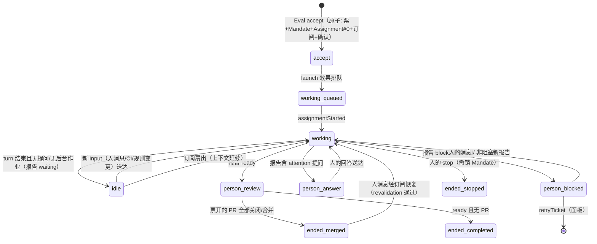

# 05 执行与工单生命周期

> 来源：官方 `docs/003-execution.md` 与源码 `src/executor/dsh.ts`、`src/core/tickets.ts`、`src/core/assignments.ts`、`src/core/stage.ts`。
> 主线：**Ticket 的状态是领域自有的**（不跟随执行会话），派工独立演进，一切故障都有结构化的恢复路径。

## 1. 状态机总览

终结结果：`completed`（无 PR 就绪）· `merged`/`closed`（其开的 PR 全部不再开放；若没开过 PR 则其跟随的 PR 全部关闭）· `dropped`（执行器判定无事可做——静默终结，除非规则要求发消息）· `stopped`（人停）。

## 2. Executor 与 worker 会话

- 会话名 `worker-<ticketId>`，目录 `<executor.directory|stateDir>/work/<短名>-<12hex票id>`；
- **prepare 命令**在首启派工前用 `sh` 运行一次（10 分钟上限，幂等——目录已存在即视为就绪），典型用 `git worktree` 建检出；失败 ⇒ 票 `failed`（不自动重试），人消息或 retry 可再次触发准备；PR 归属判定 = 分支名末段等于票短名；
- 预设 `dsh-superagent-worker`：**前台 shell 5 秒即转后台作业**（让 worker 在下一步就能收到新消息，不被长命令卡住）；工具集 `WORK_TOOLS`（文件/搜索/shell/job/web/skill/todo/子代理）；**没有**"对人提问/展示 UI/改 profile/调度其他会话"类工具；票结束后工具全部拒绝；
- worker 子代理（含嵌套）用 DSH `standard` 预设、继承 worker 权限，票结束即失去工具；
- 会话以 `danger-full-access` 以运营者 OS 用户运行——**这不是安全边界**（见 [10 安全](10-安全与信任边界.md)）。

**执行变量**（prepare 命令读环境变量，worker 在提示词里读值+描述；不含凭据）：

| 变量 | 注册者 | 值 |
| --- | --- | --- |
| `DSH_SUPERAGENT_DIR / _NAME / _TICKET` | Executor | 票目录、短名、id |
| `DSH_SUPERAGENT_BLOCKED_COMMANDS` | Executor | 禁用命令（按名调用即失败） |
| `DSH_SUPERAGENT_GITHUB_REPOSITORY / _ACCOUNT / _COMMIT_EMAIL / _NUMBER / _PR_HEAD` | GitHub | 仓库、agent 账号、提交邮箱、起源 Issue/PR 号、PR head ref |
| `DSH_SUPERAGENT_FEISHU_BOT / _CHAT` | 飞书 | bot、发起票的群 |

## 3. 并发：WorkerSlots

- 一张票从**启动派工（含 prepare）**或**唤醒 idle 会话的投递**开始持有槽位，整个 turn 期间持有；
- 上限 = `executor.maxWorkers`（默认 3，1–16）；**人的消息/状态询问可用第 max+1 个槽**，且唤醒优先于新启动——新工作永远堵不住人的延续；
- 其他 Input（如 CI）等普通槽；新启动排队在 `working/queued`；各派工并发启动，慢 prepare 只拖自己那张票。

## 4. 输入投递与"已读"语义

- 待发输入排队（首条任务消息 = 标题 + ≤1500 字符任务文本 + ≤600 字符 Trigger 卡 + 批次行 + read 指针；后续输入 = Trigger 卡或纯文本），经 `delivery` 效果逐条投递（≤4 并发，投递前复查票活性）；
- **`readAt`**：会话把消息**纳入一个 step** 时记录（step 被取消/失败不算）；票终结时，"已读但未处理"的消息（如道谢）不回 Eval，"未读且未被确认/回答/交还"的消息**回归 Eval**（除非别的票仍归属它）——`readUntil`/`readBefore` 谓词保证精确结算；
- worker 正等人（blocked/failed 且无新人消息）时：**自动输入被扣住**，只记录不投递——防 CI 噪音打扰决策；人的消息永远放行。

## 5. Worker 的回合与后台作业

- 回合内 protocol（`prompts/work.md`）：先 `orchestrator_ack`（对新请求的具体确认，回原消息之下）→ 实施与验证 → `orchestrator_report`（progress/ready/blocked/failed/dropped，PR 用 `pr_number` 绑定，提问用 `human_action`，答复用 `reply_to_trigger_id`）；
- **turn 结束时后台还有 shell 作业/子代理** ⇒ 票保持 working、占槽、不发 waiting 报告；作业完成会**在同一槽内唤醒**执行器并带结果；
- 每回合结束后台作业至多 **30 分钟**；到点杀 shell 作业（结果下回合读）、子代理允许继续，票转 waiting；
- **交接给人立即释放槽位**：ready 报告 / 提问 / blocked / failed 之后（除非又来新输入）；子代理停止；**shell 作业（如给评审用的演示服务）可以活到 Assignment 结束**——不占槽、不受 30 分钟限制、完成也不唤醒；
- 回合结束若无后台作业 ⇒ 记 `waiting` 报告（idle）。

## 6. 结束规则（细粒度）

- `ready`：跟随的 Thread 无一开放（或没开过 PR 且跟随的全关闭）⇒ 票按最后相关关闭的结果终结；否则保持 review 等 PR 事件；
- PR 事件由 GitHub Source 观察并经 `Engine.threadClosed` 进入；**PR 关闭不等价于票结束**——若恢复/重试/恢复性工作未完成、或 worker 读了它归属的 follow-up 却还没有非 progress 报告/回合结束，关闭就被挂起；
- `dropped`：直接终结（无消息，除非规则要求）；
- 票结束时：清空未投递输入、删除 attention/delivery、结束开启中的 Assignment，并 `letGo`——释放 worker 从未读到的消息与未接手的人消息回 Eval；
- 被人 stop 的票**永久终结**：不再收任何消息，那里要新工作须重新 accept。

## 7. 故障与恢复

| 情形 | 行为 |
| --- | --- |
| 瞬态失败（HTTP 408/429/5xx、连接被拒/重置/超时） | 3 次指数退避（launch 经效果退避 5s→300s；失败的 turn 收到 15/30/60s 续跑消息）；prepare 失败不重试 |
| worker 报 blocked/failed，或启动失败 | 票停止接收自动输入（CI/bot 只记录）；**工具保持可用**——人可直接进会话继续；人消息/非阻塞报告/retry 解除 |
| retry（面板/人） | 仅在 `person/delivery、person/blocked、person/failed` 可用：结束卡住的 Assignment，重排队无人认领的输入，**同一会话/目录/分支/PR** 里开新 Assignment |
| 主机重启 | 运行中 Assignment 以 `hostRestarted` 结束并按最老票优先重启，附**恢复便签**（"检查当前 worktree、git 历史与 GitHub 状态……不要重复任何已完成的对外操作"）；waiting/ready/blocked/failed 的保持原状（除非其后又有输入到达） |
| 输入投递失败 | 票显示 delivery 阶段，2s 起指数重试；成功投递/新 Assignment/票结束清除 |
| 处理暂停（pause） | 停：派工、新 Eval、Eval 超时、输入投递、回复；不断：Source 记录、运行中的回合；暂停期间到期的 Eval deadline 平移；人的消息到达已结束票则等首个 pass 恢复（revalidation 通过才恢复） |
| Source 配置失效 | 该 Source 实例被禁用（启动时校验 stored config） |

重启存活物：会话、目录、订阅、待发消息、已读记录、已存工作——全部持久于 SQLite，崩溃后自动恢复。

## 8. 交付（对外消息）

- 所有出站消息经 **Outbox**：先存回执（幂等）再入 `reply` 效果队列；**同票对同一会话的消息严格按序**（确认先于结果），前面的消息未发出则后面等待（除非它已连败 3 次成为系统问题）；
- 票的确认回复 ≤100 词（accept/研判/orchestrator_ack 三处都强制）；
- **永久性不可达**（删除的 Issue、锁定的对话、被撤回/找不到的飞书消息）⇒ 消息记 `dropped`（channelGone/channelIgnored），永不重排队；Source 停用则等待；
- GitHub 评论嵌入 `<!-- dsh-superagent:<id> -->` 幂等标记；回复已删除的评审评论自动落到 PR 对话；
- **PR 结果只通知一次聊天渠道**（稳定 id 去重）；GitHub 上 PR 本身已展示结果；
- 自动合并由 **Delivery requirements 提示词**治理（宿主无 merge 逻辑）：agent 从不以 agent 账号启用 auto-merge（GitHub 会把合并记到启用者头上）；默认条件=就绪 + 必需批准覆盖 head 提交 + 增删行合计 <200 行；推新版本前先撤 auto-merge；没有别的合并账号就人来合并；
- UI 变更的 PR 必须带真实 Before/After 证据才算 ready；自动化审查者每 PR 至多 **3 轮**（跨 worker/重启累计）；人的分支已含票内容 ⇒ worker 一句话关自己的 PR 让位。

## 9. 恢复的语义细节（容易被忽视，但对正确性至关重要）

- **中断分类**：`assignmentInterrupted` 分两类——被打断在**工作中途**的、或在其**最新报告之后又收到过输入**的 ⇒ 重启；早已报告就绪/等待且无新输入的 ⇒ 保留会话原状；
- **重复投递防护**：重启/重试把新 Assignment 该拿的消息重新下发前，会话里残留的副本（重启保留下来的）先被清走，保证"新投递是唯一副本"；
- `AgentDelivery`（`src/app/delivery.ts`）：对 DSH agent 的消息按 **requestId 至多一次**送达，跨重启由持久化会话历史 + 收件箱扫描驱动；
- worker 会话在票终结后仍可被人直接使用（工具拒绝仅针对自动调用路径——见拒绝表"锁死工具"条目的取舍）。
