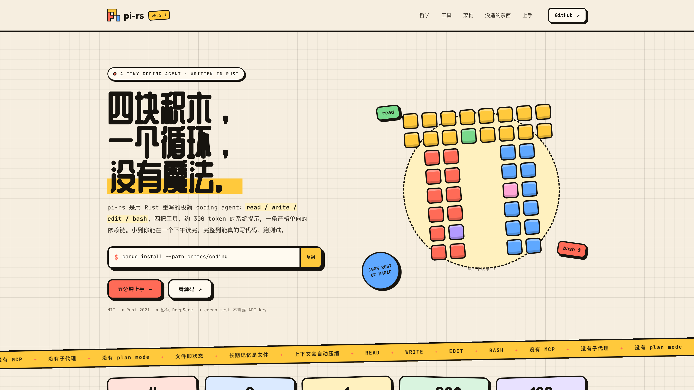

# pi-rs landing page

Static Astro site for pi-rs. It builds independently of Cargo and never
imports from `crates/`, but it is still part of the project: every claim on
the page must match what the CLI actually does.



## Develop

Requires Node 20+.

```bash
cd website
npm install
npm run dev        # http://localhost:4321
```

## Build

```bash
npm run build      # -> website/dist
npm run preview
```

## Notes

- One page (`src/pages/index.astro`), one stylesheet
  (`src/styles/global.css`), one tiny vanilla script in the page.
- Fonts are loaded from Google Fonts (Fredoka + ZCOOL QingKe HuangYou for
  display, JetBrains Mono for text). Everything else is local.
- The content is hand-written so the page has a voice of its own, but it is
  not independent: keep it in sync with the README and the actual CLI. Do not
  add features or sections the project does not have.
- `screenshot.png` is generated, don't hand-edit it: run
  `scripts/shot_website.sh` from the repo root after visual changes (needs
  Node and Chrome), then commit the regenerated image.
